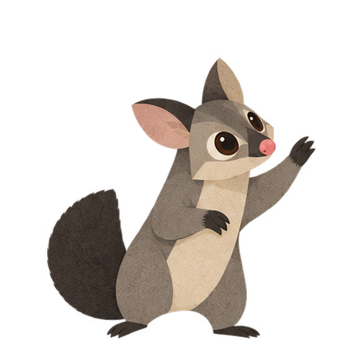
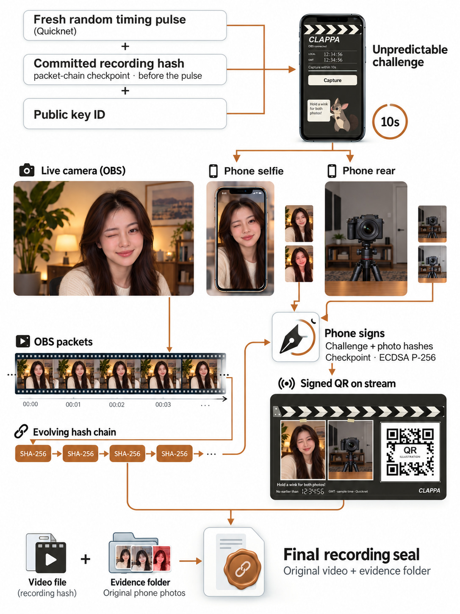
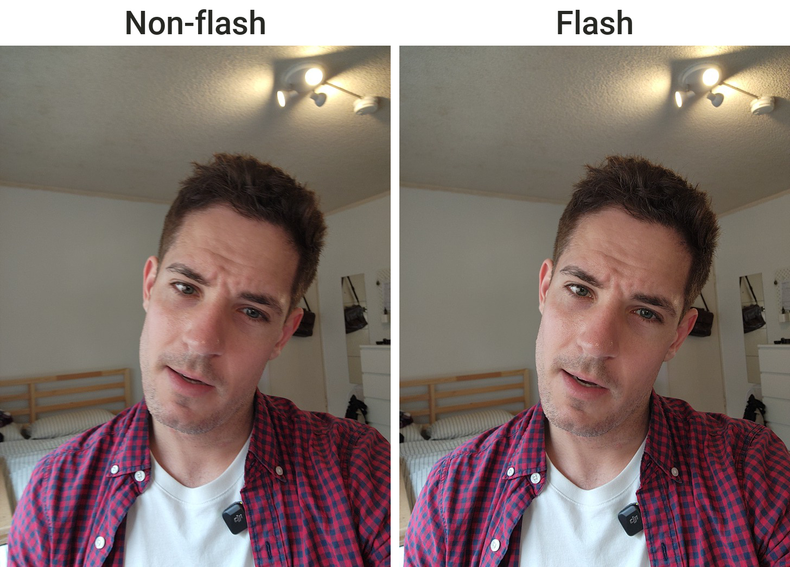
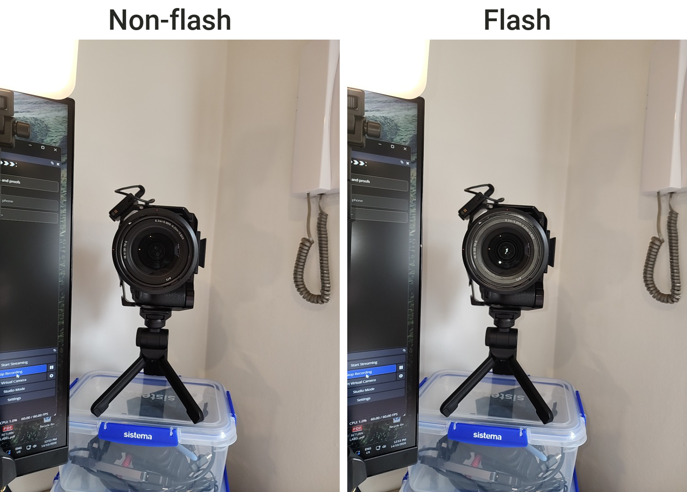

# CLAPPA

### *No cap! Clap!*

A vibe-coded clapperboard app to help streamers provide proof of what's happening live and help viewers spot AI fakes. Currently available for Android and OBS.

CLAPPA bundles pictures from your phone with video from an OBS recording so people can check them together later. Each challenge combines a prompt, lighting and a short sound riff. The choices come from fresh public randomness and are recorded in a signed proof, so later changes can be detected.

CLAPPA isn't guaranteed proof that AI couldn't have been used. It's there to make a convincing fake a hell of a lot harder. A generated fake has to be consistent across multiple different camera views and match unpredictable challenges, lighting and sounds. On a live stream, the fresh challenge and ten-second response window leave very little time to generate a matching fake. Preparing one in advance means guessing the challenge, and later edits to the recording won't match its signed hash.

## Download

**[Android app](https://github.com/dagnabbitdamien/clappa/releases/download/test19/CLAPPA-0.3.0-test19.apk)** · **[Windows OBS kit](https://github.com/dagnabbitdamien/clappa/releases/download/test19/CLAPPA-test19-kit.zip)**

[Test19 release and all files](https://github.com/dagnabbitdamien/clappa/releases/tag/test19) · [All releases](https://github.com/dagnabbitdamien/clappa/releases)

The 32-prompt update is in [Test20](docs/test20.md); the downloads above are still Test19.

This preview requires Android 9 or newer, concurrent front/rear camera support with a rear flash, and 64-bit Windows OBS. The kit includes the plugin and installer. There isn't an iPhone app yet, but anyone's welcome to make one and send a pull request. I'll approve it.

## Audience verification

CLAPPA gives a streamer and their audience a way to investigate uncertain content together while a stream is live. When something needs checking, viewers can ask for a fresh challenge and the streamer can respond on camera. The response, phone photos and challenge details become part of a shared evidence record that people can revisit after the broadcast.

Challenges at the start and end anchor the session. Further challenges and **Add a photo** document the events or details the audience wants to examine. The final seal links that history to the finished recording.

  

## Setup

1. Install the APK on your phone. Extract the Windows kit, close OBS and run `Install OBS plugin.cmd`.
2. Connect the phone and OBS computer to the same local network. Reopen OBS and choose **Docks → CLAPPA**, then pair the phone by scanning the dock's code.
3. Add the **CLAPPA proof tile** source to your OBS scene.

## How it works

**1. A fresh challenge.** Start an OBS recording and tap **Tap to clap!** on the phone. CLAPPA chooses a prompt, lighting and a short sound riff using fresh public randomness. Respond to the prompt and press **Capture**.

**2. Photos from both phone cameras.** CLAPPA captures the front and rear cameras, each without flash and then with flash: four original photos per challenge. The front camera uses the screen for illumination, with red, green or blue chosen at random; the rear camera uses its LED.

You have ten seconds to take the photo.

Example images from demo video

#### Phone front: head-tilt response

#### Phone rear: filming setup

**3. Evidence on stream.** OBS briefly displays the flash photos, then the non-flash photos, beside an animated QR code that viewers can scan in Viewer mode.

**4. A signed record.** The phone signs the challenge, SHA-256 hashes of the original photo files, the recording ID and OBS packet-chain checkpoints. Each checkpoint contains the SHA-256 packet-chain head, packet count and byte count, linking the challenge to the audio/video packets already recorded.

The QR carries those signed details. The original pictures stay in the proof folder. After a successful challenge, you can add one optional extra photo with **Add a photo**.

**5. Finish and seal.** You can **Stop & seal** a recording within 30 seconds of any completed challenge. We recommend a challenge at the start and another at the end to anchor the recording.

When recording finishes, the phone signs the video file's SHA-256 hash and byte size. Keep the original recording and its proof folder together, including the final seal.

## Checking a recording

Open CLAPPA in Viewer mode and scan the animated code on a stream. It provides the signed challenge details and freshness information, and can replay the clapper sound. The photos shown on stream provide the phone views of the response and setup.

Checking the exact recording needs the original file and its sealed evidence bundle. A Twitch or YouTube transcode has different bytes, so it won't match the original file hash.

## Unpredictable challenge structure

CLAPPA doesn't need an enormous challenge space; even a few unpredictable choices make advance generation a gamble. An attacker who prepares the wrong prompt, flash colour or sound has spent time generating a response to a challenge that never appears, while repeated checks require fresh responses tied to particular moments in the stream.

The front screen flashes red, green or blue at random. With 32 prompts and 2,560 sound riffs, that gives **32 prompts × 3 front-flash colours × 2,560 riffs = 245,760 combinations**.

An ordered pair of start and end checks gives **245,760 × 245,760 = 60,397,977,600 combinations**.

### Prompts

- Take a selfie.
- Turn to your left and take a selfie.
- Turn to your right and take a selfie.
- Face the other way and take a selfie.
- Cover your nose with your left hand.
- Cover your nose with your right hand.
- Rest your chin on your hand.
- Hold an open hand beside your face.
- Give us a smile.
- Tilt your head to one side.
- Hold a wink for both photos.
- Give a thumbs-up with your left hand.
- Give a thumbs-up with your right hand.
- Make a peace sign beside your face with your left hand.
- Make a peace sign beside your face with your right hand.
- Tilt your head towards your left shoulder.
- Tilt your head towards your right shoulder.
- Hold your left hand open beside your face.
- Hold your right hand open beside your face.
- Hold your left fist beside your face.
- Hold your right fist beside your face.
- Point upward beside your face with your left index finger.
- Point upward beside your face with your right index finger.
- Point to your left cheek with your left index finger.
- Point to your right cheek with your right index finger.
- Touch your left ear with your left hand.
- Touch your right ear with your right hand.
- Rest your chin on your left hand.
- Rest your chin on your right hand.
- Hold up three fingers beside your face with your left hand.
- Hold up three fingers beside your face with your right hand.
- Raise your eyebrows and open your mouth.

[Challenge selection and compatibility](docs/challenge-prompts.md)

## Twitch

Linking a Twitch account can add account evidence to your proofs. In the OBS dock, Twitch audience challenges can also let chat invite you to take a challenge: three different viewers sending `🎬` within 15 seconds buzz the phone. You decide whether to accept. There's a two-minute cooldown, and chat can't choose the prompt or start the camera for you.

Live account authorization and an audience-triggered challenge still need full confirmation in this preview.

## More details

- [Documentation index](docs/README.md)
- [Developer setup](docs/GITHUB.md)
- [Architecture](docs/CURRENT-ARCHITECTURE.md)
- [Protocol and verification](protocol/README.md)
- [Test20 build and validation notes](docs/test20.md)

No project license has been selected. Existing third-party licenses and asset attributions still apply.
